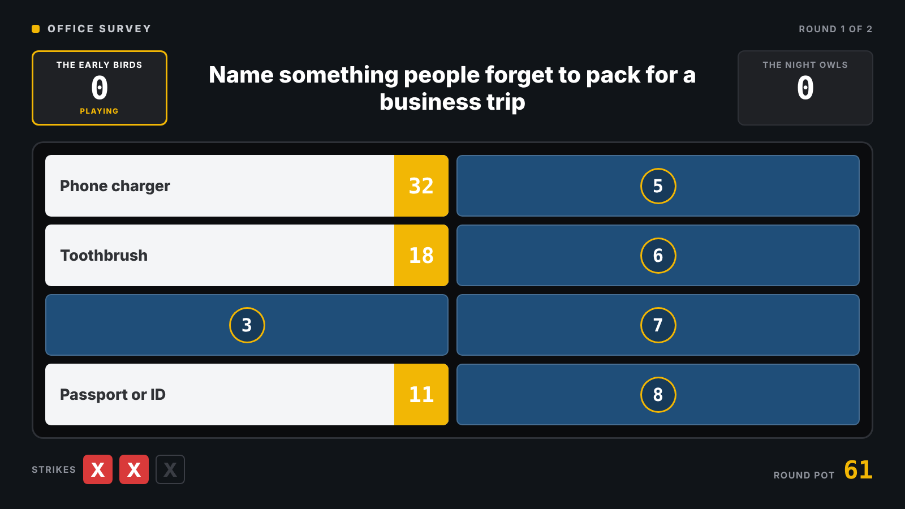

# Quiz Board

A tiny, reusable game-show board for live audience quizzes, inspired by the classic "survey says" format. Two teams try to guess the answers on a hidden board. A host reveals tiles as they're found, hands out strikes for wrong guesses, and can optionally show a picture and an explanation behind each answer.

Use it to close a talk, run a workshop icebreaker, recap a training session or liven up a team event. Everything the audience sees comes from a JSON file: write a new quiz and you have a new game, no code changes needed.

This is a host-operated board: players answer aloud, and the host decides which answers count, when to offer a steal, and who wins each round. Players do not need a device or an account. You need a browser, a quiz file, and a second screen or projector for the audience; keep the console on your private screen because it shows every answer.



## Features

- **Projector board** with flip-tile reveals, a full-screen strike X, team scores and a round pot.
- **Two game modes**: play with two teams or switch to a single-player scorecard.
- **Hidden operator console** for a co-host: reveal answers, give strikes, award points, show details.
- **Fuzzy matching helper**: type what the audience said and the console suggests the closest answer. A human still makes the final call.
- **Optional details overlay**: an image and caption per answer, shown only when the operator decides.
- **Built-in sounds** generated in the browser (reveal, strike, round win), so there are no audio files to license. You can swap in your own.
- **Fully data-driven**: title, questions, answers, points, aliases, images and theme colours come from a JSON file; team names and strike limit can be set at game setup.
- **Works offline**: a single HTML file, no build step, no dependencies. Select a quiz JSON file to start; no quiz is loaded automatically.
- **Recovery during a live show**: undo up to 80 game actions during the current session. The console saves the current game in browser storage; after a reload, choose **Load quiz… → Resume saved game**. Undo history is not saved.

## Quick start

1. Clone or download this repository and open a terminal in its root folder.
2. Serve the folder locally with Python 3:
   ```bash
   python3 -m http.server 8000 --bind 127.0.0.1
   ```
   Open `http://localhost:8000/` in your browser. No Python? Double-click `index.html` instead; the app also supports loading a quiz from a local file.
3. Click **Load quiz…**, choose `quizzes/sample.json`, and select **Two teams** or **Single player**. Set the names and strike limit, review the question summary, then click **Start quiz**. The sample contains three rounds and needs no extra assets.
4. Click **Open display window**, move the new window onto the projector screen, and double-click it for full screen (or press F11).
5. Click once on the display to enable sound. Browsers require an interaction before playing audio; a banner reminds you until you do.
6. Check that the console shows **Display connected**, then try revealing an answer and awarding the pot.

Use one operator console per browser origin (the same protocol, host and port), and one game per relay. Local windows share a channel and saved-game slot; relay clients all receive each other's messages.

> Rehearse once on the real setup. Allow pop-ups for the page, check the projector resolution, and walk through a round with sound on.

## Running a game

1. In two-team mode, pick the team in control. In solo mode, the player is the only recipient of the round pot.
2. When a team gives an answer, press **Reveal** on the matching row (or its number key). If the phrasing is vague, type what they said into the search box: the console ranks the closest answers, and **Enter** reveals the best match. Check the suggestion before accepting it. If the best match is already on the board, the button says so, which usually means a strike.
3. Wrong answer: press **Strike**. Once the team is out of strikes, use **Steal chance** to give the other team one guess. In solo mode, skip the steal.
4. Award the round pot to the winning team or player using **Award to …**, including in solo mode. Further reveals add no points once the pot is awarded. Steals and awards are manual decisions; reaching the strike limit does not end the round automatically.
5. Use **Show evidence** on any revealed answer to put its image and caption on the projector. **Esc** in the console closes it.
6. Use **Reveal remaining answers** at the end of the round, then **Next round**. Award the pot before leaving: changing rounds clears the board and unawarded pot. Returning to a round creates a fresh board while retaining total scores.

Made a mistake? **Undo last action** (or `Ctrl` + `Z`, `Cmd` + `Z` on macOS) reverts a game action, including an award or round change. **Reset round** clears the board, strikes and pot but keeps total scores, including any points already awarded for that round. **New game** resets all scores and returns to the first round with the current quiz and names.

### Keyboard shortcuts (console)

| Key | Action |
|---|---|
| `1`–`8` | Reveal that answer |
| `X` | Strike |
| `E` | Toggle details for the last revealed answer |
| `B` | Black screen on/off |
| `/` | Jump to the search box (`Enter` reveals the best match) |
| `Ctrl` + `Z` / `Cmd` + `Z` | Undo |
| `Esc` | Close the details overlay |

Shortcuts are ignored while you're typing in an input or using a select, except `Esc`. In the answer search box, `Enter` reveals the best match.

### Save and resume

The console saves the quiz, scores and current round after each action using `localStorage`. To resume after closing or reloading it, reopen the same address in the same browser profile, click **Load quiz…**, and choose **Resume saved game**. A reloaded display resyncs when the console is running. Only one game is saved per origin, and browser storage must be available; private browsing or clearing site data can remove it. Image and sound files must remain available at their referenced paths.

## How it works

The app is one HTML file that runs in two modes:

| View | URL | Shown to | Role |
|---|---|---|---|
| Display | `index.html?view=display` | The audience (projector) | Renders state and plays animations and sounds. Has no controls. |
| Control | `index.html?view=control` (the default) | The operator only | The single source of truth. Every click changes the game state. |

```
 Operator console  ──── state + event ────▶  Projector display
 (state + logic)   ◀──────── ping ─────────  (renders state only)
```

Each action in the console updates the game state and broadcasts it, with a short event describing what just happened so the display knows which animation and sound to play. The display pings the console every 1.5 seconds; the console uses this to show **Display connected** and to resend the state if the display is behind. Because the display only renders what it receives, reloading it mid-game simply resyncs it.

### Sync modes

- **Local mode (default)**: both windows run in the same browser on one laptop with an extended screen. They talk through the browser's `BroadcastChannel` API, plus `window.postMessage` between the console and the display window it opened. No network, no server, no Wi-Fi worries at the venue.
- **Remote mode (optional)**: the operator uses a separate laptop. Both windows connect to a small WebSocket relay (`relay/`) that forwards messages between them. See [Remote mode](#remote-mode-optional).

### Events

| Event | Effect on the display |
|---|---|
| `reveal` | Flips the tile, plays the reveal sound, adds its points to the round pot |
| `strike` | Shows the big X (one per strike so far) and plays the buzzer |
| `evidence` | Opens or closes the details overlay for an answer |
| `control` | Highlights the team currently playing |
| `steal` | Hands control to the other team for one guess and flashes "Steal!" |
| `award` | Moves the round pot to a team's score and plays the round-win sound |
| `reveal-all` | Reveals the remaining tiles one by one, greyed out, without awarding points |
| `blackout` | Hides or shows everything (black screen) |
| `round` | Loads a round and deals a fresh board |
| `undo` | Reverts the last action, without animation |

## Customising

### Write your own quiz

Create a JSON file in `quizzes/`, then open the console and choose it in the setup form (or open with `?quiz=quizzes/my-quiz.json`). The setup form lets you set team names and the strike limit before starting. Dropping a quiz JSON onto the console also loads it into the form. Games are saved; if one is available, you can resume it from the setup screen.

The `?quiz=` shortcut requires serving the page over HTTP; use the file picker when opening `index.html` directly. Relative image and sound paths resolve from `index.html`, not from the quiz JSON file. Selecting a JSON file does not upload its neighbouring assets: copy those into the served project folder yourself. In remote mode, the display machine must also be able to load those assets.

```json
{
  "title": "Office survey",
  "teams": ["The Early Birds", "The Night Owls"],
  "maxStrikes": 3,
  "theme": {
    "accent": "#F2B705",
    "tile": "#1F4E79",
    "background": "#101418"
  },
  "sounds": {
    "reveal": "sounds/ding.mp3",
    "strike": null,
    "win": false
  },
  "rounds": [
    {
      "question": "Name something people forget to pack for a business trip",
      "multiplier": 1,
      "answers": [
        {
          "text": "Phone charger",
          "points": 38,
          "aliases": ["charger", "cable", "usb cable", "power bank"],
          "evidence": {
            "image": "evidence/charger.png",
            "caption": "Over a third of the office has borrowed a charger from the hotel front desk."
          }
        },
        {
          "text": "Toothbrush",
          "points": 21,
          "aliases": ["toothpaste", "toiletries", "dental kit"]
        }
      ]
    }
  ]
}
```

#### Field reference

| Field | Required | Description |
|---|---|---|
| `title` | no | Shown in the top-left of the board and in the console header. Default: `Quiz` |
| `teams` | no | Team names, or one player name in solo mode. Default: `["Team Red", "Team Blue"]` |
| `mode` | no | `teams` or `solo`. Default: `teams`. Choose the mode and enter names in the setup form. |
| `maxStrikes` | no | Suggested strike limit before the steal chance, 1 to 5. Default: `3`. Set or change it in the setup form before starting. |
| `theme.accent` | no | Points blocks, highlights and the round pot |
| `theme.tile` | no | Colour of hidden tiles |
| `theme.background` | no | Stage background |
| `sounds.reveal` / `.strike` / `.win` | no | Path to an audio file to replace a built-in sound. `null` keeps the built-in one, `false` mutes it |
| `rounds[].question` | recommended | The survey question shown above the board. Defaults to empty text if omitted |
| `rounds[].multiplier` | no | Multiplies the round's points, e.g. `2` for a double round. The board shows the multiplied values |
| `rounds[].answers` | yes | 1 to 8 answers. Tile numbers follow this order, so list them from highest to lowest points |
| `answers[].text` | yes | Text revealed on the tile. It shrinks to fit, but aim for under about 40 characters |
| `answers[].points` | recommended | Numeric points for the answer; omitted or invalid values become `0`. Use finite, non-negative numbers. Totalling 100 per round feels most authentic |
| `answers[].aliases` | no | Other wordings the fuzzy matcher should recognise. The more, the better the suggestions |
| `answers[].evidence.image` | no | Path to an image shown in the details overlay |
| `answers[].evidence.caption` | no | One or two sentences under the image. A caption without an image is shown on its own, in larger text |

The console checks the file when loading it and tells you what's wrong (missing `rounds`, an answer without `text`, more than 8 answers, and so on).

### Answer details (images and captions)

The optional `evidence` block lets you back up an answer with an image and a short explanation: a photo, a chart, a screenshot, a source. Put images in `evidence/` and reference them from the quiz file. PNG or JPG at roughly 16:9 looks best. An answer without details shows **No evidence** in the console, and a missing file shows "Image not found" with the expected path on the display, which is easy to catch in rehearsal.

### Sounds

The default sounds are synthesised with the Web Audio API, so the app ships with no audio files. To use your own, add files to `sounds/` and reference them under `sounds` in the quiz JSON. Only use audio you have the rights to. The **Sound** checkbox in the console mutes everything.

### Look and feel

Colours come from the quiz file's `theme`. Fonts and layout are in the `<style>` block at the top of `index.html`. The board is laid out at 1600×900 and scaled to fit any screen, letterboxed if the screen isn't 16:9. Fonts load from Google Fonts when online and fall back to system fonts offline.

## Remote mode (optional)

Use this only if the console can't run on the presenter's laptop.

The relay needs Node.js 18 or newer and npm. Serve the app on each device, or host it at an address both devices can reach. Keep the local HTTP server running separately from the relay.

```bash
cd relay
npm install
export RELAY_TOKEN="$(openssl rand -hex 16)"
printf 'Relay token: %s\n' "$RELAY_TOKEN"  # copy into both browser URLs
npm start
```

Then open the console with:

```
http://localhost:8000/?relay=ws://<relay-host>:8080&token=<the token>
```

**Open display window** passes the relay settings on to the display. To open the display on another machine instead, use the same URL with `view=display` added.

Replace `<relay-host>` with the relay machine's reachable hostname or IP address and `<the token>` with the printed value. `localhost:8000` refers to the device running that browser: it works only if that device is serving its own copy of the app. For example, with the app served locally on each device, the display URL is `http://localhost:8000/?view=display&relay=ws://<relay-host>:8080&token=<the token>`. Both devices must reach relay port `8080` (or the port set with `PORT`). An HTTPS app page requires a secure `wss://` relay.

The relay forwards messages and stores nothing. Without `RELAY_TOKEN`, anyone who can reach the port can drive your board, and the relay warns you at start-up. Plain `ws://` is unencrypted, which is fine on a trusted local network. For anything beyond that, put the relay behind TLS and use `wss://`.

## Project structure

```
.
├── index.html            # The whole app: display + control views
├── quizzes/              # Quiz files (includes a sample quiz)
├── evidence/             # Images referenced by the quiz
├── sounds/               # Optional custom audio
├── relay/                # Optional WebSocket relay for remote mode
│   ├── relay.js
│   └── package.json
└── docs/                 # Screenshots for this README
```

## Browser support

Recent Chrome, Edge and Firefox. In local mode, keep both windows in the same browser profile.

## Disclaimer

This is an independent project. It is not affiliated with, endorsed by or derived from any television game show, and it uses none of their names, logos, artwork or sounds.

## License

This project is licensed under the [MIT License](LICENSE).
